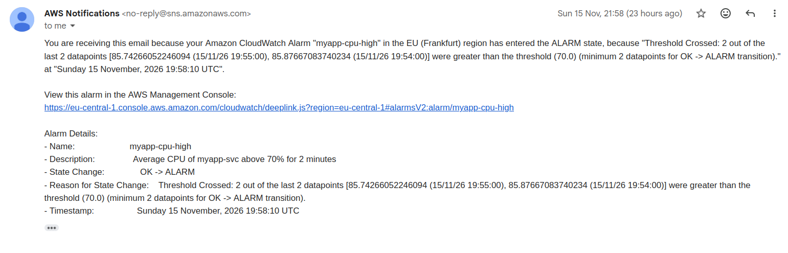
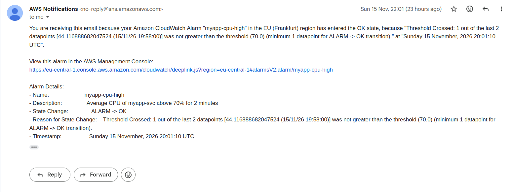
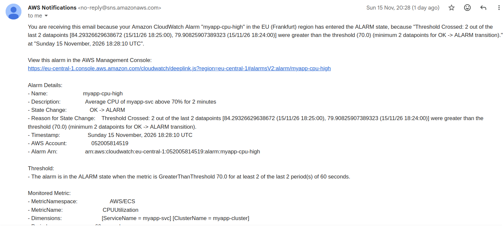
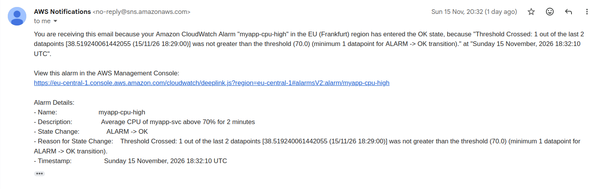

# Сповіщення

**Покращує:** доступність — з «дізнатися від користувачів» до листа через ≈ 4 хв після початку перевантаження.  
**Коштує:** можливі хибні спрацювання, поріг треба підбирати; лист приходить із затримкою.  
**Відкинули:** p95 > 500 мс (у тестах p95 не перевищував 75 мс — не спрацював би), спрацювання без періоду (flapping).

Сповіщення налаштоване в `infra/monitoring.tf`: `cpu_high`, SNS-топік і підписка на пошту.

## Умова

Якщо середнє завантаження процесора в сервісі дві хвилини поспіль вище 70 %, приходить лист про проблему. Коли процесор падає нижче 70 %, приходить другий лист, що все в нормі.

Після першого `terraform apply` треба підтвердити підписку за посиланням з листа від AWS, інакше листи не приходитимуть.

## Чому така умова

Масштабування тримає процесор близько 60 %. Тому поріг 70 % спрацює лише тоді, коли автоматика не встигає або вже працюють усі 4 задачі.

Дві хвилини потрібні, щоб не реагувати на короткі стрибки.

Процесор обрано, бо його видно на тій самій панелі, що й масштабування. Латентність залежить ще й від бази та мережі, тому з нею легше отримати хибну тривогу.

## Що було під час тесту

Ці 4 хвилини складаються з двох частин. Дві хвилини аларм чекає, поки процесор протримається високим. Ще приблизно дві хвилини метрика йде в CloudWatch. Лист про норму приходить швидше, бо для нього вистачає однієї нормальної хвилини.

У прогоні з кешем усе було так само, листи прийшли близько 20:28 і 20:32.

## Чи нормально чекати 4 хвилини

Для такого сповіщення так. Коли воно приходить, сервіс працює, а масштабування вже саме додає задачі. Лист просто попереджає, що сервіс на межі.

Але якщо сервіс почне повертати помилки, 4 хвилини це забагато. Для справжнього сервісу варто додати швидке сповіщення на помилки і слати його в месенджер, бо пошту часто читають пізно. Користувач бачить не процесор, а те, що сайт гальмує, тому сповіщення про помилки й повільні відповіді для нього важливіші.
