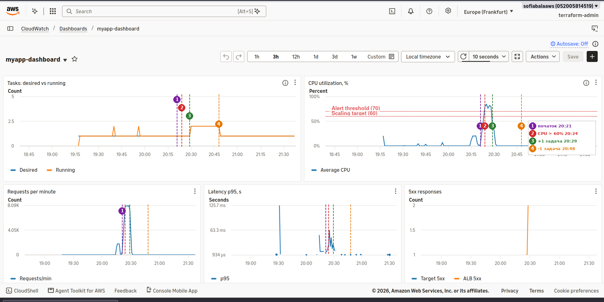
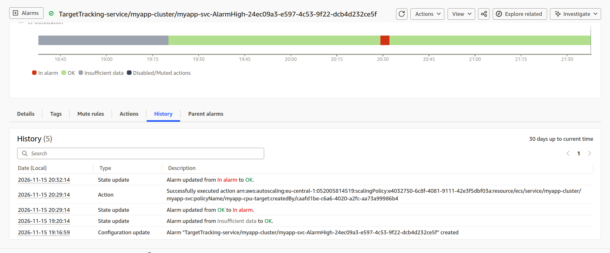
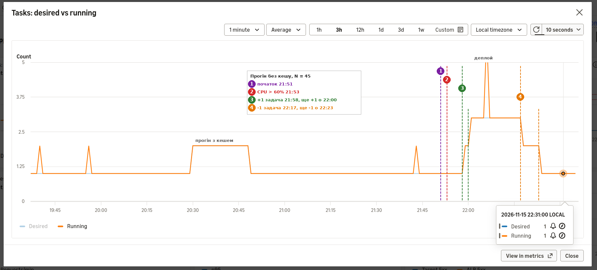

# Автомасштабування

**Покращує:** пропускну здатність під піком — з ≈ 125 запитів/с (одна задача на 100 % CPU) до ≈ 500 (4 задачі); у тесті на 100 запитів/с p95 75 мс і менше 0,01 % помилок.  
**Коштує:** ≈ $0,014 за годину кожної додаткової задачі; реакція ≈ 5 хв; застосунок мусить бути stateless.  
**Відкинули:** масштабування за кількістю запитів (сервіс упирається в CPU, а не в базу), більшу задачу замість кількох, ціль 80 % (немає запасу на 5 хв).

**Панель — покращує:** спостережуваність — з окремих сторінок консолі до 5 графіків (задачі, CPU, запити, p95, 5xx) на одному екрані.  
**Коштує:** плата за метрики Container Insights.  
**Відкинули:** середню латентність замість p95, окремий Grafana/Prometheus.

Політика описана в `infra/autoscaling.tf`, панель — в `infra/monitoring.tf`.

## Параметри

Сервіс масштабується за середнім завантаженням процесора. Ціль 60 %, мінімум 1 задача, максимум 4. Після додавання задачі політика чекає 60 секунд, після вилучення 5 хвилин.

## Чому процесор і чому 60 %

Під час тестів процесор задач доходив майже до 100 %, а процесор бази не піднімався вище 12 %. Тобто сервіс упирається саме у свій процесор, а не в базу, тому ця метрика тут підходить. Якби сервіс здебільшого чекав на базу, краще було б масштабувати за кількістю запитів на задачу.

Нова задача з'являється приблизно через 5 хвилин. Увесь цей час навантаження тримають ті задачі, що вже працюють, тому потрібен запас. З цілі 60 % до 100 % навантаження може вирости ще на дві третини. Якщо поставити 80–90 %, задачі впруться в 100 % раніше, ніж прийде допомога. Якщо поставити 30–40 %, зайві задачі працюватимуть постійно і коштуватимуть грошей. Тести показали, що 60 % вистачає: масштабування спрацювало вчасно, і помилок майже не було.

## Що таке cooldown

Cooldown — це пауза після масштабування. Нова задача стартує не одразу, і якийсь час процесор ще високий. Без паузи політика думала б, що допомоги досі немає, і додавала б задачі знову і знову.

Якщо поставити cooldown рівним нулю, сервіс швидко дійде до максимуму задач, хоча вистачило б однієї. Потім процесор впаде, зайві задачі приберуться, процесор знову виросте, і все почнеться спочатку. Задачі постійно запускатимуться і зупинятимуться, а відповіді то пришвидшуватимуться, то сповільнюватимуться.

## Панель під час тестів

Було два прогони по 45 користувачів. Перший з кешем, близько 20:20–20:30. На знімку позначено початок навантаження, момент, коли процесор перетнув 60 %, появу нової задачі і її вилучення.

У історії аларму видно, що він спрацював і запустив масштабування.

Другий прогін без кешу, близько 21:50–22:00. Процесор був вищим, тому задач стало три. На графіку видно обидва прогони. Короткий пік до п'яти задач — це не масштабування, а деплой після тесту.

## Чому задача з'являється не одразу

В обох прогонах від перетину порогу до нової задачі минуло близько 5 хвилин. Метрика процесора приходить раз на хвилину і з запізненням. Аларм чекає три хвилини підряд з високим процесором, щоб не реагувати на випадкові стрибки. Потім задача ще запускається і проходить перевірку, перш ніж на неї піде трафік.

## Чому вилучення відбувається набагато пізніше

Зайві задачі зникли лише через 15–25 хвилин після тесту. Для вилучення аларм чекає 15 хвилин з низьким процесором, а між вилученнями ще 5 хвилин паузи. Так зроблено навмисно. Якщо прибрати задачу зарано, а навантаження повернеться, нову доведеться знову чекати кілька хвилин. Тому задачі додаються швидко, а прибираються повільно.
