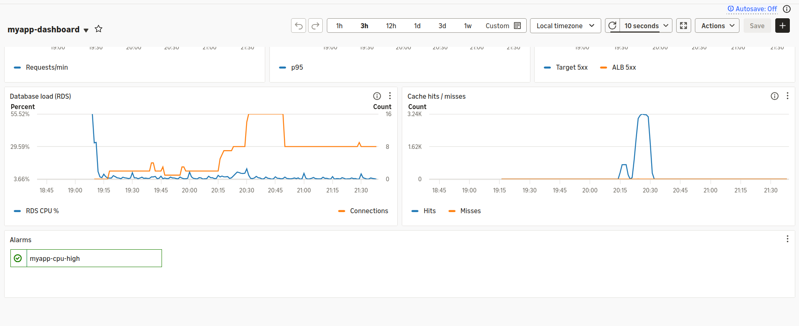
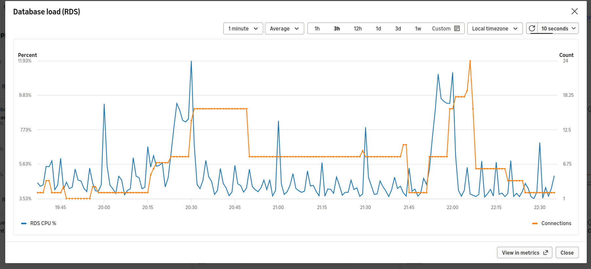

# Кешування

## Як працює кеш

Найчастіший запит у тесті — список магазинів `GET /shop`. Він працює за схемою cache-aside. Сервіс спершу шукає список у кеші. Якщо знайшов, одразу повертає. Якщо ні, бере з бази, кладе в кеш на 45 секунд і повертає. Якщо кеш раптом недоступний, сервіс не падає, а просто йде в базу.

Кеш — це Valkey (те саме, що Redis) в ElastiCache, у приватній мережі. Локально замість нього звичайний контейнер. Код у `my_project/cache.py`, інфраструктура в `infra/cache.tf`.

## Чому не кеш у пам'яті процесу

Під навантаженням працює до чотирьох задач, і в кожній по два процеси. Якби кожен процес мав свій кеш, вийшло б вісім окремих копій. Кожна наповнювалась би сама, тому в базу йшло б більше запитів. Різні користувачі могли б бачити різні версії списку, залежно від того, на яку задачу потрапили. А нова задача стартувала б з порожнім кешем саме тоді, коли навантаження найбільше. Спільний Redis один на всіх, тому таких проблем немає.

## Як порівнювали

Тест прогнали двічі по 45 користувачів: з кешем і без. Кеш вимикається змінною `cache_enabled` в Terraform, після чого треба перезапустити деплой.

## Результати

| | Без кешу | З кешем |
|---|---|---|
| p95 | 75 мс | 67 мс |
| Запитів за секунду | 100 | 100 |
| Запитів до бази за секунду | 330 | ≈ 200* |
| Влучання в кеш | — | 99,9 % |

\* розраховано: запити списку з кешу не доходять до бази.

З кешем 95 % запитів вкладались у 67 мс, без кешу у 75 мс. Тобто кеш пришвидшив відповіді. Кількість запитів за секунду в обох прогонах однакова, близько 100. Так вийшло тому, що кожен користувач у тесті чекає на відповідь і робить паузу, тож кількість запитів залежить від кількості користувачів, а не від швидкості сервера.

Майже всі звернення до кешу були влучаннями, близько 99,9 %. Промах трапляється приблизно раз на 45 секунд, коли закінчується термін дії запису.

## Застарілі дані

Новий магазин одразу видно за його адресою, бо окремий магазин не кешується. А от у списку він може з'явитися лише через 45 секунд, поки не оновиться кеш.

Цей час можна зменшити кількома способами. Найпростіше — поставити менший термін дії, але тоді частіше доведеться ходити в базу. Можна видаляти список з кешу після кожного запису, але в тесті записів дуже багато, і кеш майже не працював би. Ще можна одразу оновлювати кеш після запису або показувати користувачу його власний новий магазин без кешу.
