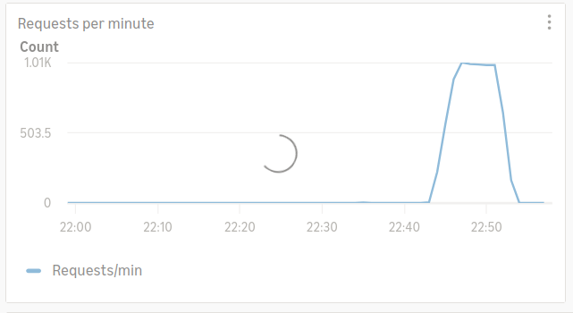
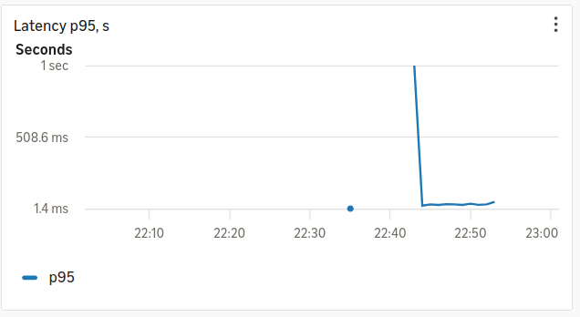
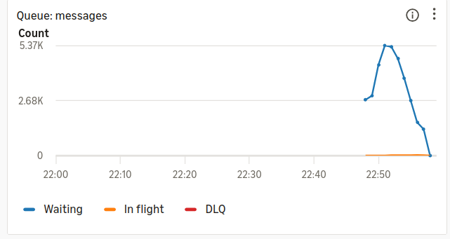
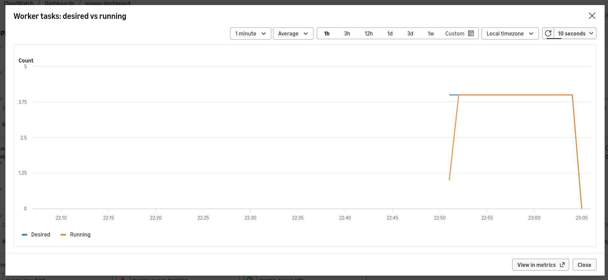

# Запис через чергу

**Покращує:** пік записів не кладе базу і не сповільнює API — 7463 записи без помилок, p95 сервісу кілька мілісекунд навіть при черзі в 5,4 тисячі повідомлень.  
**Коштує:** 202 замість 201, клієнт мусить перевіряти статус; повторна доставка вимагає ідемпотентності; запуск обробника з нуля ≈ 3 хв.  
**Відкинули:** синхронний запис з довгою операцією, FIFO-чергу (дорожча і повільніша, а дублікати все одно відсікає обробник).

## Як це працює

Для створення магазину є окремий запит `POST /shop/async`. Сервіс не пише в базу одразу, а кладе повідомлення в чергу SQS і відповідає кодом 202. Окремий обробник забирає повідомлення з черги і створює магазин. Якщо повідомлення не вдається обробити п'ять разів, воно йде в окрему чергу для невдалих повідомлень.

Обробник — це той самий образ, просто запущений командою `python worker.py`. Перед записом він чекає 200 мс, щоб імітувати довгу операцію. Код у `worker.py`, інфраструктура в `infra/sqs.tf` і `infra/worker.tf`.

## Що змінилося для клієнта

Раніше клієнт одразу отримував код 201 і готовий магазин. Тепер він отримує 202, тобто «прийнято, буде зроблено». Відповідь приходить швидко, але сам магазин з'являється трохи пізніше. Якщо, наприклад, такий телефон уже є, клієнт дізнається про це не одразу, а коли перевірить статус.

## Як клієнт дізнається результат

У відповіді є номер задачі. За ним клієнт перевіряє статус через `GET /jobs/{id}`. Статус буває «в черзі», «обробляється», «готово» з даними магазину або «помилка» з причиною. Ще можна було б зробити так, щоб сервер сам повідомляв клієнта, коли все готово, але опитування найпростіше.

## Доставка «щонайменше один раз»

SQS гарантує, що повідомлення точно дійде, але іноді воно приходить двічі. Наприклад, обробник створив магазин і впав, не встигнувши видалити повідомлення. Тоді через 30 секунд повідомлення повернеться в чергу, і його візьме інший обробник. Втратити повідомлення гірше, ніж отримати двічі, тому черги працюють саме так.

## Що буде при повторній обробці

Без захисту повторне повідомлення створило б другий магазин або впало б з помилкою, хоча все вже зроблено. Тому обробник записує номер кожної виконаної задачі в окрему таблицю, в тій самій транзакції, що й магазин. Якщо таке повідомлення прийде ще раз, обробник побачить номер у таблиці і нічого не запише. Це перевіряє окремий тест.

## Масштабування обробника

Кількість обробників залежить від довжини черги. Поки повідомлень мало, працює один. Що довша черга, то більше обробників, максимум чотири. Якщо черга п'ять хвилин порожня, обробники вимикаються зовсім.

Запуск з нуля займає кілька хвилин. В одній перевірці повідомлення оброблялось близько трьох хвилин, бо обробник спершу мав запуститися. Для фонового запису це нормально, адже клієнт уже отримав відповідь.

## Навантажувальний тест

```bash
SCRIPT=queue.js RATE=15 ./loadtest/run.sh queue
```

## Результати

За 10 хвилин сервіс прийняв 7463 записи без жодної помилки. Постановка в чергу з погляду клієнта займала 39 мс (p50), 64 мс (p95) і 119 мс (p99). Більшість цього часу — дорога по мережі до Франкфурта.



Латентність сервісу не росла, хоча черга росла до тисяч повідомлень. Після першої хвилини p95 тримався на рівні кількох мілісекунд увесь тест. Сплеск на самому початку — це перші запити, коли процеси сервісу ще тільки відкривали з'єднання з SQS і Redis.



Черга росла, бо записи надходили швидше, ніж їх встигали обробляти. Найбільше в ній було близько 5,4 тисячі повідомлень



Обробник масштабувався від довжини черги. До початку тесту працювало 0 обробників. Коли спрацював аларм на чергу, у черзі вже були тисячі повідомлень, тому політика одразу поставила максимум: о 22:51 з'явився перший обробник, о 22:52 працювали всі чотири. Тобто повний цикл виглядав так: 0 → 4 → 0.


